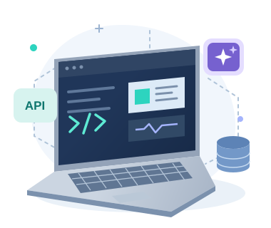

## Hey 👋, I'm Mahmoud Mohamed!

**Software Engineer | Full-Stack Development & AI Integration**

[Portfolio](https://www.mahmoud-mohamed.dev/) · [LinkedIn](https://www.linkedin.com/in/mahmoud-mohamed-abdel-aal/) · [Email](mailto:mahmoudabbamalik@gmail.com) · [YouTube](https://www.youtube.com/@WebTriks)

I'm a **Software Engineer specializing in full-stack web development**, with **3+ years of experience in web development**. I build end-to-end applications with React, Next.js, TypeScript, Node.js, Express, and SQL/NoSQL databases, and integrate AI into practical product features.

 

### 🧐 More about me

- 💼 Contributed to web products at **Clicks Digitals** and **LAUNCH WORKZ**.
- 🛠️ Built a shared frontend foundation across **5 Next.js projects**.
- 🤖 Built **Rihla's AI travel assistant** with Gemini and the Vercel AI SDK.
- ⚡ I use AI assistants for development, debugging, and reviews, and validate the results.
- 🧩 I care about reusable components, maintainable architecture, and reliable APIs.
- 🌍 Based in **Egypt**, open to full-time opportunities.
- 💬 Ask me about **full-stack development, React, Next.js, Node.js, and AI integration**.
- 📫 Explore my work at [mahmoud-mohamed.dev](https://www.mahmoud-mohamed.dev/).

 

### 🔨 Languages and tools

  &nbsp;&nbsp;
  &nbsp;&nbsp;
  &nbsp;&nbsp;
  &nbsp;&nbsp;
  &nbsp;&nbsp;
  &nbsp;&nbsp;
  &nbsp;&nbsp;
  &nbsp;&nbsp;
  &nbsp;&nbsp;
  

**Also work with:** Tailwind CSS · TanStack Query · Redux Toolkit · Zustand · Prisma · Socket.IO  
**AI integration:** Vercel AI SDK · Google Gemini

### 🛠️ Selected projects

<table>
<tr>
<td width="50%" valign="top">

<h3>🚌 Rihla</h3>

A bus booking platform with an AI travel assistant, temporary seat holds, safeguards against double booking, QR tickets, and Paymob <strong>test checkout</strong>.

<strong>Next.js · TypeScript · Express · PostgreSQL · Prisma · Gemini</strong>

<a href="https://bus-booking-platform-nine.vercel.app/">Live demo</a> · <a href="https://github.com/Eng1Mahmoud/booking-rihla">Code</a> · <a href="https://www.youtube.com/watch?v=77Rvu1e63Kc">Video</a>

</td>
<td width="50%" valign="top">

<h3>🛒 Al-Baraka</h3>

An Arabic grocery storefront and admin dashboard with guest checkout, delivery-area pricing, server-side cart validation, and Web Push notifications.

<strong>Next.js · TypeScript · Express · MongoDB · Zustand</strong>

<a href="https://al-baraka-frontend.vercel.app/">Live demo</a>

</td>
</tr>
<tr>
<td width="50%" valign="top">

<h3>⚽ Football Pitch Booking</h3>

A booking application with half-hour slots, overnight bookings, protection against overlapping reservations, and a staff dashboard.

<strong>Vue 3 · TypeScript · Pinia · Express · MongoDB</strong>

<a href="https://booking-stadium-phi.vercel.app/">Live demo</a> · <a href="https://github.com/Eng1Mahmoud/booking-stadium">Code</a>

</td>
<td width="50%" valign="top">

<h3>💬 World Chat</h3>

A real-time chat application with online status, typing indicators, and read receipts. The linked repository contains the frontend.

<strong>Next.js · TypeScript · Socket.IO</strong>

<a href="https://world-chat-apps.vercel.app/">Live demo</a> · <a href="https://github.com/Eng1Mahmoud/frontend-chat-app">Frontend code</a>

</td>
</tr>
</table>

<strong>💼 More about my experience</strong>

 

- **Frontend Engineer · Clicks Digitals** — Mar–Jun 2026  
  Owned frontend development across five Next.js projects and built a shared architecture and dashboard foundation that reduced initial development time by approximately 50%.

- **Software Engineer (Frontend) · LAUNCH WORKZ** — Nov 2023–Mar 2026  
  Built public, customer, and admin interfaces for a US rental marketplace and a telecom platform, including Google Maps and Stripe integrations for the rental marketplace.

- **Web Development Intern · CodSoft** — Sep–Oct 2023  
  Completed a series of hands-on web development projects during a project-based internship.

---

**Have a role or project in mind?** Let's connect on [LinkedIn](https://www.linkedin.com/in/mahmoud-mohamed-abdel-aal/) or [email](mailto:mahmoudabbamalik@gmail.com).
